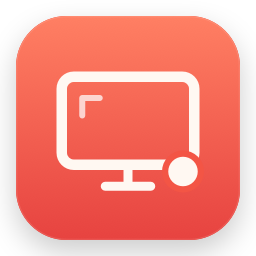

<p align="center">
  
</p>

# Screenroom

A free, open-source screen recorder and screenshot editor for macOS, released under the [MIT license](LICENSE). Capture your screen, include app audio when you want it, and annotate screenshots with drawing, arrows, shapes, and text.

Built with **SwiftUI, AppKit, and ScreenCaptureKit**. No web runtime, third-party dependencies, audio drivers, accounts, or uploads.

[](https://github.com/SalehMuAm/Screenroom/actions/workflows/ci.yml)

**[Download v1.0.4 for Apple silicon](https://github.com/SalehMuAm/Screenroom/releases/download/v1.0.4/Screenroom-1.0.4-macos-arm64.zip)** · [Checksum](https://github.com/SalehMuAm/Screenroom/releases/download/v1.0.4/Screenroom-1.0.4-macos-arm64.zip.sha256) · [Release notes](https://github.com/SalehMuAm/Screenroom/releases/tag/v1.0.4)

[Installation](#install) · [Usage](#use-screenroom) · [Build from source](#build-from-source) · [Contributing](CONTRIBUTING.md) · [Changelog](CHANGELOG.md)

**Public preview:** macOS 15+, Apple silicon (M1 or later). The download is ad-hoc signed and not notarized. See [installation](#install) for first-launch guidance and [known limitations](#permissions-storage-and-limitations) before relying on it for an important session.

## What it does

- **Screenshots:** capture an area, a window, or a full display as PNG.
- **Recordings:** record an entire display immediately, or choose an area or window. Save MP4 at 30 or 60 fps, with dimensions capped at 4K.
- **Optional system audio:** include sound from the captured software. Microphone capture is always off.
- **Quick annotations:** freehand drawing, arrows, rectangles, ellipses, text, undo/redo, copy, and export.
- **Native library:** find screenshots and replay recordings with macOS playback controls.
- **Menu bar and shortcuts:** capture without keeping the main window open.

## Install

### Download the app

Requires **macOS 15 or later** and **Apple silicon (M1 or later)**. You do not need Xcode, a developer account, or an audio driver to run the download. There is no prebuilt Intel or universal app.

1. Download the [app ZIP](https://github.com/SalehMuAm/Screenroom/releases/download/v1.0.4/Screenroom-1.0.4-macos-arm64.zip) and [SHA-256 checksum](https://github.com/SalehMuAm/Screenroom/releases/download/v1.0.4/Screenroom-1.0.4-macos-arm64.zip.sha256) into the same folder.
2. In Terminal, open that folder and verify the download. For the usual Downloads folder:

   ```sh
   cd ~/Downloads
   shasum -a 256 -c Screenroom-1.0.4-macos-arm64.zip.sha256
   ```

   Continue only when the result says `OK`.

3. Unzip the app and move **Screenroom.app** into **Applications**. Quit an older copy before replacing it.
4. Open Screenroom from Applications. If macOS blocks this unnotarized preview, follow the app-specific guidance below.
5. Start a capture and grant access in **System Settings → Privacy & Security → Screen & System Audio Recording** when prompted. Quit and reopen Screenroom if macOS asks.

**Preview signing status:** this download is ad-hoc signed and **not notarized by Apple**. macOS may block its first launch. If you trust the source and verified the download, follow [Apple’s instructions for opening an unnotarized app](https://support.apple.com/en-us/102445). This preview’s Screen Recording permission may need to be granted again after an update. A Developer ID-signed, notarized distribution is not available yet.

The [installation guide](docs/SETUP.md) also covers permission problems, updating, installing for one user, and uninstalling.

### Build from source

Install **Xcode 16 or later**, with a macOS 15+ SDK, and Git. A stable code-signing identity is recommended so capture permissions survive rebuilds.

```sh
git clone https://github.com/SalehMuAm/Screenroom.git
cd Screenroom
./scripts/build-app.sh
./scripts/install-app.sh --no-build
./scripts/run.sh --no-build
```

The build automatically chooses an available Developer ID Application or Apple Development certificate. [Setup](docs/SETUP.md) explains how to create a development identity, select Xcode, and install into `~/Applications`.

For a temporary local build without a certificate:

```sh
SIGNING_IDENTITY=- ./scripts/build-app.sh
./scripts/install-app.sh --no-build
./scripts/run.sh --no-build
```

Ad-hoc signing is suitable for trying the app, but changed builds can invalidate macOS capture permissions. The build targets the architecture of the Mac running it; Intel source builds have not been runtime-verified.

## Use Screenroom

| Action | Shortcut |
| --- | --- |
| Take a screenshot | **⌘⇧6** |
| Start recording; press again to stop and save | **⌘⇧7** |

Keep Screenroom running for global shortcuts. Closing the window leaves it in the menu bar; quitting the app disables them.

**Your first screenshot:** open the webpage or app you want to capture, then press **⌘⇧6**. On a fresh installation, drag to select an area and release to capture it; press **Esc** to cancel. The image opens in Screenroom's editor. Add annotations, then use **Copy** or **Save PNG** to keep the edited version. If you previously chose Window or Screen, Screenroom remembers that choice; choose **Screenshot → Area** to restore area selection.

Recording defaults to the **entire display under your pointer**, with no selection dialog. To record a smaller target, select **Recording → Area** or **Window** first. Those modes ask you to select the target. Recording and screenshot source choices are remembered separately.

Turn **System audio** on before recording to capture app sounds. It is off by default and your choice is remembered. The preview shows whether the saved file contains an audio track.

For screenshots, capture or open an image, add your annotations, then copy or export the edited image. The original capture remains saved.

## Permissions, storage, and limitations

- Grant access in **System Settings → Privacy & Security → Screen & System Audio Recording**. Reopen the installed app when macOS requests it. Use the same installed copy rather than switching between build folders.
- A window recording follows that window’s content filter; protected media may not be capturable.
- Video trimming and annotations on video are not included.
- macOS can stop recording under storage pressure. Screenroom warns below 5 GiB free and refuses to start below 1 GiB, but that minimum cannot prevent every system interruption.
- Global shortcuts can conflict with other apps. Registration failures appear in Settings; another app can also intercept a shortcut. See [troubleshooting](docs/SETUP.md#troubleshooting).
- In the 1.0.4 preview, manual checks with full-screen apps, Spaces, Stage Manager, and physical keyboard shortcuts remain incomplete.
- This is an early preview. Test a short recording before relying on it for an important session.

## Your files stay on your Mac

| Content | Default location |
| --- | --- |
| Screenshots | `~/Pictures/Screenroom/` |
| Recordings | `~/Movies/Screenroom/` |
| Library index | `~/Library/Application Support/Screenroom/library.json` |

Screenroom does not upload captures, request microphone access, or include analytics. Removing an entry from the library does not delete the original media file.

## Develop and contribute

Fork the repository, make a focused change, and open a pull request. [CONTRIBUTING.md](CONTRIBUTING.md) covers setup, the project layout, tests, and manual capture checks.

```sh
swift build --configuration release
swift test --configuration release
```

GitHub Actions checks the Swift tests and app packaging on macOS. Capturing the screen and exercising macOS privacy prompts still require a real Mac and manual testing. [Release instructions](docs/RELEASING.md) cover packaging, checksums, signing, and notarization.

## Documentation and support

| Guide | What it covers |
| --- | --- |
| [Installation and troubleshooting](docs/SETUP.md) | Downloads, source builds, capture permissions, updates, and uninstalling. |
| [Contributing](CONTRIBUTING.md) | Forking, project structure, tests, and manual verification. |
| [Changelog](CHANGELOG.md) | Changes and known limitations by version. |
| [Releasing](docs/RELEASING.md) | Signing, packaging, checksums, and publishing. |

[Report a bug or request a feature](https://github.com/SalehMuAm/Screenroom/issues/new/choose). Include your Screenroom version, macOS version, Mac chip, and steps to reproduce. Use harmless sample content and remove private information from attachments.

## License

[MIT](LICENSE) © 2026 SalehMuAm. You can use, modify, and distribute Screenroom, including forks, under the license’s terms.
